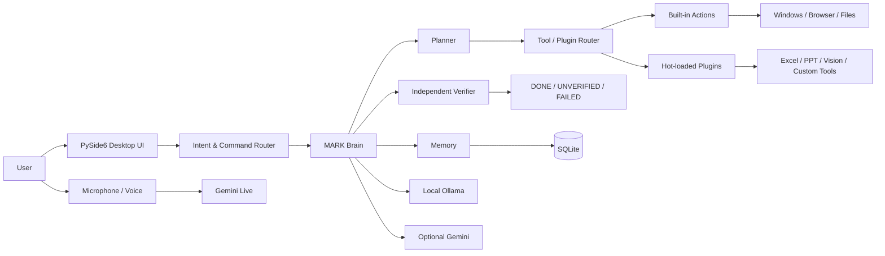
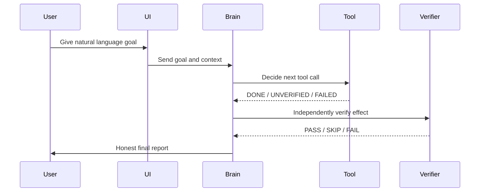

# MARK - Complete Presentation Documentation

**Document purpose:** This document contains the full project details, slide structure, spoken script, screenshots placeholders, demo flow, architecture, and technical explanation needed to create a proper MARK project PPT.

**Project:** MARK - Windows Desktop AI Assistant  
**Repository:** `sudhanshu0691/mark`  
**Prepared from:** Checked-in source code and project documentation  
**Presentation language:** Hinglish  
**Primary platform:** Windows 10/11, 64-bit  

---

## 1. Recommended slide count

For a 15-20 minute presentation, use 18-22 slides:

1. Title slide
2. Project name and one-line summary
3. Problem statement
4. Proposed solution
5. Objectives
6. Scope
7. Target users
8. Key features
9. Live demo introduction
10. System architecture
11. Planning and execution loop
12. AI and model routing
13. Desktop UI
14. Built-in actions and plugins
15. Files, Excel and PowerPoint automation
16. Visualization and diagrams
17. Vision Department
18. Privacy and security
19. Honest verification system
20. Technology stack
21. Testing and current status
22. Installation and setup
23. Limitations
24. Future scope
25. Conclusion
26. Demo / Q&A

---

# Slide 1: Title

## MARK

**A Multi-Agent Windows Desktop Assistant**

Subtitle:
- Local-first AI
- Voice and text interaction
- Desktop, browser and file automation
- Verified execution

Presenter details:
- Name:
- Roll number:
- College / university:
- Guide:
- Date:

---

# Slide 2: What is MARK?

## One-line definition

MARK ek Windows-first desktop assistant hai jo user ke natural language instructions ko samajhta hai, suitable tools ko plan karta hai, actions execute karta hai, aur real-world effect independently verify karta hai.

## MARK in short

- PySide6 based native desktop application
- Typed commands plus Gemini Live voice
- Ollama local AI as default text and planning backend
- Windows automation, browser, files, notifications and calls
- Hot-loaded Python plugins
- Vision monitoring and local inference
- Excel, PowerPoint, screenshots and visualization support

---

# Slide 3: Problem statement

## Traditional PC users face repeated manual work

- Ek simple task ke liye multiple apps open karne padte hain.
- File search, copy, rename, move and organize karna time-consuming hai.
- Excel, browser, PowerPoint aur desktop tools separate interfaces use karte hain.
- Voice assistants may claim success without checking the actual result.
- Cloud-only assistants cannot always work offline or access local PC actions safely.

## Practical problem

User ko PC par instructions dene ke liye:

**one assistant interface + real tool access + result verification**

chahiye, not only text answers.

---

# Slide 4: Proposed solution

## MARK solution

MARK ek central assistant runtime provide karta hai jo:

1. User message ko natural language se intent me convert karta hai.
2. Required tool or plugin choose karta hai.
3. A bounded plan-execute loop run karta hai.
4. Actual effect verify karta hai.
5. Done, failed or unverified status clearly batata hai.

## Core promise

> "MARK does not hide uncertainty. It reports only what it can prove."

---

# Slide 5: Objectives

- Reduce repetitive Windows desktop operations.
- Enable both text and voice interaction.
- Provide local AI processing using Ollama.
- Keep optional cloud voice/text capabilities separate.
- Automate files, applications, browser, messaging and office tools.
- Support extensibility through plugins.
- Verify world-changing actions before claiming success.
- Keep sensitive configuration local and out of Git.
- Provide a native, modern, single-page desktop interface.

---

# Slide 6: Scope

## In scope

- Windows desktop control
- Application launch and window management
- File and folder operations
- Browser automation
- Web search
- Notifications and reminders
- WhatsApp / calling actions
- Excel workbook operations
- PowerPoint creation and editing
- Visualization and technical drawings
- Local memory
- Voice interaction
- Camera and vision monitoring
- Plugin loading

## Out of scope or optional

- Guaranteed support for every third-party app or browser version
- Continuous cloud storage
- Qubo live camera hardware validation when the user has not configured it
- Formula calculation inside openpyxl; external Excel or LibreOffice recalculation is needed
- Guarantee of success for protected system actions or UAC prompts

---

# Slide 7: Target users

- Students
- Developers
- Content creators
- Office users
- Research users
- Windows power users
- People who want voice-controlled PC assistance
- People who want local AI with optional cloud features

---

# Slide 8: Key features

| Feature | Meaning |
|---|---|
| Text assistant | Typed natural-language commands |
| Live voice | Gemini Live microphone conversation |
| Local AI | Ollama text, coding and vision models |
| Desktop automation | Open apps, control windows and mouse |
| File automation | Search, copy, move, rename, delete and zip |
| Browser automation | Search and interact with existing browser sessions |
| Calls and messaging | WhatsApp, calls and notification handling |
| Excel | Workbook inspection and editing |
| PowerPoint | Create, edit and verify PPTX files |
| Visualization | UML, C4, ERD, flowcharts, sequence and DXF |
| Vision | Human detection and camera event monitoring |
| Plugins | Python extensions loaded automatically |
| Memory | Recent conversation and long-term SQLite/local data |

---

# Slide 9: User example scenarios

## Scenario 1

"Rahul ko WhatsApp pe message karo ki main 10 minute mein aa raha hoon."

MARK:
- resolves the contact
- opens WhatsApp Desktop
- navigates to the chat
- sends the message
- verifies visible UI or reports UNVERIFIED

## Scenario 2

"Downloads se last week's PDF desktop par copy karo."

MARK:
- interprets file criteria
- searches the allowed file location
- applies permission rules
- copies the file
- checks existence and evidence

## Scenario 3

"Is folder ka module diagram bana do."

MARK:
- scans project structure
- identifies modules and relationships
- creates SVG, PNG and PDF
- reports output paths

---

# Slide 10: System architecture



## Architecture explanation

MARK is divided into:

- **UI layer:** `main.py`, `ui.py`
- **Planning layer:** `core/brain.py`
- **Model routing:** `core/llm.py`
- **Tool dispatch:** `main.py` and action modules
- **Plugin system:** `core/plugins.py`, `plugins/`
- **Verification:** `core/verify.py`
- **Memory:** `memory/`
- **Vision:** `vision_department/`

---

# Slide 11: Plan-Act-Verify loop



## Rules

- Maximum default planning steps: 10
- DONE only means a tool claims success and verification supports it
- FAILED means the action failed or verification contradicted success
- UNVERIFIED means execution happened but the effect could not be confirmed
- The final SUCCESS report can be downgraded to PARTIAL
- Repeated identical calls are blocked

---

# Slide 12: AI model routing

## Ollama - default local backend

Configured models:

- Text: `qwen3:4b`
- Code: `qwen3:4b`
- Fast: `qwen3:4b`
- Vision: `qwen2.5vl:3b`

## Gemini - optional cloud backend

Used for:

- Gemini Live native audio voice
- Optional cloud text requests
- Memory/provider features where configured

## Offline profile

The offline profile forces Ollama and disables Gemini cloud inference.

---

# Slide 13: Desktop UI

MARK uses a native PySide6 interface.

## Holographic command center

- One-page main stage
- Central state and MARK core
- Conversation panel
- Command bar
- Live information panel
- Tasks and alerts panel
- Verification panel
- System status panel
- Vision monitor panel

## UI behaviour

- Floating glass panels
- Drag and resize support
- Panel lock support
- ON/OFF panel switches
- Layout and switch state saved/restored
- Worker-safe UI update bridge

---

# Slide 14: Built-in action modules

The project includes action modules for:

- File operations
- Browser control
- Desktop control
- Computer settings
- Open applications
- Weather
- Flight search
- Messages and notifications
- Reminders
- Screen reading and OCR
- YouTube
- System monitoring
- Calls and phone session handling
- Web search
- Code and developer agent operations
- Game/software updates
- Gesture mouse
- Identity and camera monitors

These modules are registered as tools and can be selected by the model or direct intent routing.

---

# Slide 15: Plugin architecture

## Hot reload

MARK watches `plugins/` and reloads changes in approximately two seconds.

## Plugin capabilities

- A Python file can declare one or more tools.
- A plugin can provide an `on_load` hook.
- It can receive notifications.
- It can declare metadata, permissions and timeout.
- It can call other MARK tools through `PluginContext.call_tool`.
- The plugin manager checks tool-name conflicts.

## Included plugin areas

- Excel
- PowerPoint
- Visualization
- Hardware control
- Media studio
- Workspace modes
- Weather
- Notification mode
- Timers
- Quick notes
- Vision
- App integration

---

# Slide 16: File and Office automation

## File operations

- Search by name or text
- Copy, move and rename
- Append and open
- Zip and unzip
- Recycle Bin or permanent delete modes
- Allowed-root and blocked-path policies
- Post-action existence and checksum checks

## Excel plugin

Supported:

- Create and inspect workbooks
- Profile sheets
- Append data
- Edit cells and formulas
- Formatting and sorting
- Dedupe
- Summaries
- Native charts
- LibreOffice recalculation

## PowerPoint plugin

Supported:

- Create presentation
- Add and reorder slides
- Add text and images
- Duplicate and delete slides
- Rename / save as
- Reopen PPTX and count slides before success

---

# Slide 17: Visualization

MARK can generate:

- Module and package diagrams
- UML class diagrams
- C4 components
- ERD / entity relationship diagrams
- ISO 5807 flowcharts
- UML sequence diagrams
- DXF technical drawings

## Supported inputs

- Python
- JavaScript / TypeScript
- Java
- SQL files
- SQLite databases
- ORM-style models

## Outputs

- SVG
- PNG
- PDF
- DXF for technical drawings

The visualizer uses Pillow and ezdxf and does not require Graphviz or Java.

---

# Slide 18: Vision Department

MARK includes an optional Vision Department.

## Features

- Embedded VISION panel
- Local Ultralytics human detection
- Optional Qubo cloud RTSPS connector
- Motion and human detection agents
- Event database
- Dashboard
- Localhost-only API
- Camera consent and monitoring controls
- Event retention

## Supplied model

- Checkpoint: `assets/models/human.pt`
- Size: 6,259,289 bytes
- Loaded successfully with Ultralytics
- Architecture/task: DetectionModel / detect
- Label map: Human = class 0
- Local inference validated

## Current limitation

A real Qubo account and live camera were not available for this report, so live camera authentication and stream behavior remain acceptance tasks.

---

# Slide 19: Memory and state

MARK uses several state systems:

- SQLite conversation history
- Local long-term memory
- Task records
- Notification state
- Vision event database
- Runtime configuration
- Layout configuration
- Work logs

## Privacy rules

The following are local-only and excluded from Git:

- `config/api_keys.json`
- `config/contacts.json`
- `config/permissions.json`
- Memory files
- Runtime database and data
- Local authentication profiles

---

# Slide 20: Security and permissions

## File permission policy

`config/permissions.json` controls:

- Allowed roots
- System path access
- Delete mode
- Permanent delete confirmation
- Additional blocked paths

## Sensitive actions

MARK treats dangerous operations with additional care:

- Permanent delete
- System shutdown
- Formatting
- Money transfer
- Sending messages to unnamed recipients

## API key safety

- Keys use local OS credential storage where supported
- Private configuration is excluded
- API key examples are provided separately
- Users should revoke a key if it may have been exposed

---

# Slide 21: Honest verification system

MARK has independent verification for selected tool effects.

## Three statuses

| Status | Meaning |
|---|---|
| DONE | Action completed and verification passed |
| UNVERIFIED | Action ran but confirmation was inconclusive |
| FAILED | Action failed or result contradicted the claim |

## Verification evidence

Depending on the operation, MARK may check:

- File existence
- File checksum
- Open app/window
- Text visible on screen
- Screenshot condition
- Slide count after saving
- Workbook file reopening
- Database or task state

---

# Slide 22: Technology stack

| Area | Technology |
|---|---|
| Language | Python |
| UI | PySide6 / Qt |
| Local AI | Ollama |
| Cloud voice/text | Google Gemini SDK |
| Local speech | faster-whisper |
| Speech output | edge-tts |
| Windows automation | pywinauto, pywin32, pyautogui |
| Browser | Playwright / Chrome DevTools Protocol |
| Office | openpyxl, python-pptx |
| PDF | pypdf, pdfplumber |
| Vision | Ultralytics, OpenCV, MediaPipe |
| Data | SQLite, pandas |
| Diagrams | Pillow, ezdxf |
| Testing | pytest |

---

# Slide 23: Setup and installation

## Supported Python

- Python 3.11 64-bit
- Python 3.12 64-bit

## Commands

```bat
setup_windows.bat
run_mark.bat
```

## Console / diagnostic commands

```bat
.\.venv\Scripts\python.exe main.py
.\.venv\Scripts\python.exe -m tooling.setup --doctor
.\.venv\Scripts\python.exe -m core.llm check
.\.venv\Scripts\python.exe -m core.llm pull
```

## Optional offline mode

```bat
$env:MARK_PROFILE = "offline"
.\.venv\Scripts\python.exe main.py
```

---

# Slide 24: Testing

The project has 24 test modules in the `tests/` folder covering:

- Action confirmation
- Risk and verification
- Memory database
- Local routing
- Gemini routing
- Runtime reliability
- Call/phone behaviour
- Vision API and events
- Camera source
- Gesture mouse
- Plugin orchestration
- Project permissions
- Visualization

## Validation command

```powershell
$markTestTemp = Join-Path (Get-Location) ('.mark-test-' + [guid]::NewGuid().ToString('N'))
.\.venv\Scripts\python.exe -m pytest tests -q -p no:cacheprovider --tb=short --basetemp $markTestTemp
```

## Reported baseline

The project analysis report recorded 77 tests passing in 32.03 seconds in the supplied Python 3.11.0 environment.

---

# Slide 25: Demo plan

## 1-minute demo

1. Open MARK.
2. Show the single-page holographic UI.
3. Ask: "mark status".
4. Open a simple app.
5. Show the verification panel.

## 3-minute demo

1. Show Ollama provider status.
2. Create a small text file or search for a file.
3. Generate a module or flowchart.
4. Create a PowerPoint with 2-3 slides.
5. Show the generated PPTX and list its slides.

## 5-minute demo

1. Demo typed command.
2. Demo voice microphone.
3. Demo plugin discovery.
4. Demo Excel or PPT workflow.
5. Open Vision panel and explain local model and current hardware limitations.
6. Finish with DONE / UNVERIFIED / FAILED examples.

---

# Slide 26: Advantages

- Local-first text processing
- Natural language PC control
- Native Windows UI
- Plan-act-verify workflow
- Honest status reporting
- Hot-load plugins
- Existing browser/session support
- Office and visualization automation
- Multi-agent style tool routing
- Local conversation memory
- Privacy-oriented local configuration

---

# Slide 27: Limitations

- Live hardware workflows depend on the target Windows machine.
- WhatsApp, call, notification and UI automation may differ between app versions.
- Browser attachment may require Chrome or Edge debugging startup.
- Formula results need external Excel or LibreOffice recalculation.
- Local model speed depends on RAM and GPU.
- Camera, microphone and OTP acceptance depend on physical devices/account access.
- Qubo live streaming may depend on third-party community software and exact firmware.
- OCR requires Tesseract engine or compatible Windows OCR setup.
- UAC confirmation may require manual user action.

---

# Slide 28: Future enhancements

- Stronger central approval for every destructive operation
- Sandboxed plugin execution
- Typed desktop operations instead of generated scripts
- More robust browser/session recovery
- Mobile companion app
- Multi-language voice improvements
- More camera providers
- Face authentication tuning
- Cloud synchronization with explicit consent
- Plugin marketplace / signed plugins
- CI/CD pipeline and packaged installer
- Automatic dependency and model setup
- Dashboard analytics
- Broader live end-to-end Windows test suite

---

# Slide 29: Conclusion

MARK is not only a chatbot; it is a Windows desktop operating assistant.

It combines:

- Local and cloud AI routing
- Desktop and browser automation
- Office tools
- Visualization
- Memory
- Plugins
- Vision
- Independent action verification

Its main engineering advantage is that it does not guarantee success blindly. It returns DONE, UNVERIFIED or FAILED based on actual evidence.

---

# Slide 30: Closing / Q&A

## Closing line

"MARK aims to convert natural language intent into verified Windows actions."

## Questions to answer

- Why MARK instead of a normal chatbot?
- Why Ollama as default?
- How is verification implemented?
- How are plugins loaded?
- How is privacy handled?
- What is tested and what is hardware-dependent?
- What are the future plans?

---

# Presenter speaking script

## Opening

"Main MARK project ke baare mein present karunga. MARK ek Windows desktop AI assistant hai jo text ya voice se instructions leta hai aur real PC actions execute karta hai."

## Problem

"Aaj hum file search, app open, message sending, Excel editing aur browser tasks alag-alag manually karte hain. MARK ek unified interface dene ki koshish karta hai."

## Architecture

"MARK ka core ek plan-act-verify loop follow karta hai. User goal receive hone ke baad brain suitable tools decide karta hai. Tool execute hone ke baad independent verifier actual effect check karta hai."

## Voice and AI

"Text ke liye default local Ollama backend use hota hai. Voice ke liye Gemini Live optional hai. Offline profile mein cloud requests disable ho sakti hain."

## Plugins

"Plugins folder me Python file add hone par MARK usko automatically load karta hai. Isse Excel, PowerPoint, visualization aur future capabilities add ki ja sakti hain."

## Security

"API keys, contacts and runtime memory local-only hain. Permission file se file access aur delete policy control ki ja sakti hai."

## Verification

"MARK ka sabse important feature honest verification hai. Agar action hua but visible effect confirm nahi hua, to MARK UNVERIFIED bolta hai. Agar result contradict hua, FAILED bolta hai."

## Vision

"Vision Department me local human detection model embedded hai. Camera support optional hai aur exact live hardware testing target device par baaki hai."

## Closing

"MARK natural language intent ko actual verified PC operations mein convert karne ka goal follow karta hai."

---

# Demo commands

## Safe demo suggestions

- "mark status"
- "open calculator"
- "open notepad"
- "what is the current system status?"
- "create a text file on desktop with this content"
- "search the project folder for README"
- "show available plugins"
- "create a module diagram for this project"
- "create a 3-slide presentation on MARK"

## Unsafe or permission-sensitive demos

Avoid during a first live presentation unless permissions and approval are ready:

- Permanent delete
- System shutdown
- App uninstallation
- Sending real WhatsApp messages
- Making real calls
- Financial operations
- Installing software silently
- Exposing private API keys

---

# Source map for the PPT

Use these repository files for further screenshots or references:

| Topic | Source |
|---|---|
| Overview | [README.md](README.md) |
| Setup | [SETUP.md](SETUP.md) |
| Architecture report | [PROJECT_ANALYSIS_REPORT.md](PROJECT_ANALYSIS_REPORT.md) |
| Runtime status | [STATUS.md](STATUS.md) |
| Vision | [VISION_DEPARTMENT.md](VISION_DEPARTMENT.md) |
| Visualization | [VISUALISATION.md](VISUALISATION.md) |
| Audit | [REAL_AUDIT_REPORT.md](REAL_AUDIT_REPORT.md) |
| UI implementation | [ui.py](../ui.py) |
| Runtime entry point | [main.py](../main.py) |
| Planner | [core/brain.py](../core/brain.py) |
| Model routing | [core/llm.py](../core/llm.py) |
| Plugin system | [core/plugins.py](../core/plugins.py) |
| PowerPoint plugin | [plugins/ppt_studio.py](../plugins/ppt_studio.py) |

---

# PPT visual and design guidance

## Color scheme

- Background: deep navy / black
- Primary cyan: `#22D3EE`
- Secondary violet: `#9B8CFF`
- Success green: `#49F3B3`
- Warning orange: `#FF9B5E`
- Failure red: `#FB7185`
- Text: soft white / `#DCEAF5`

## Font

- Headings: Aptos Display / Segoe UI Semibold
- Body: Aptos / Segoe UI

## Layout

- Use 16:9 widescreen.
- One main idea per slide.
- Maximum 5 bullets per slide.
- Use diagrams instead of long paragraphs.
- Add screenshots only after live output is available.
- Keep code snippets to 3-5 lines.
- Use Hindi/Hinglish text consistently.

---

# Final document checklist

Before creating the PPT:

- [ ] Replace presenter details.
- [ ] Add screenshots of the actual UI.
- [ ] Record one successful demo.
- [ ] Record one UNVERIFIED or FAILED example.
- [ ] Export architecture as PNG/SVG.
- [ ] Add team/college logo if required.
- [ ] Verify local Ollama is running.
- [ ] Verify plugin list is visible.
- [ ] Remove private keys, contacts and local paths.
- [ ] Do not claim Qubo hardware testing unless live-tested.
- [ ] Check every PPT value against the final demo machine.
